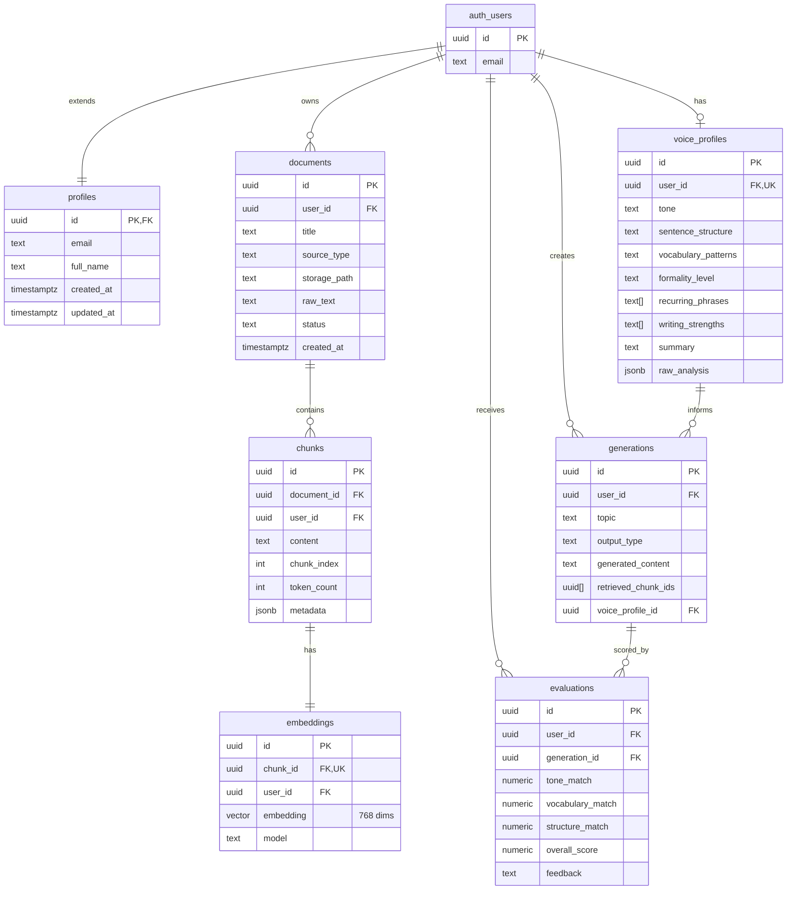

# Database Schema — Personal Voice Skill

Complete PostgreSQL schema for Supabase with pgvector.

**SQL file:** [`supabase/migrations/001_initial_schema.sql`](../supabase/migrations/001_initial_schema.sql)

## Entity Relationship Diagram



## Tables

### `profiles` (users)

Extends `auth.users` with app-specific metadata. One row per signed-up user, created automatically via trigger on signup.

| Column | Type | Description |
|--------|------|-------------|
| `id` | UUID (PK, FK → auth.users) | User ID |
| `email` | TEXT | Email address |
| `full_name` | TEXT | Display name |
| `created_at` | TIMESTAMPTZ | Created timestamp |
| `updated_at` | TIMESTAMPTZ | Last updated |

---

### `documents`

Uploaded writing samples (PDF, TXT, pasted text, LinkedIn posts).

| Column | Type | Description |
|--------|------|-------------|
| `id` | UUID (PK) | Document ID |
| `user_id` | UUID (FK) | Owner |
| `title` | TEXT | Display title |
| `source_type` | TEXT | `pdf`, `txt`, `paste`, `linkedin` |
| `storage_path` | TEXT | Supabase Storage path (files only) |
| `original_filename` | TEXT | Original file name |
| `file_size` | INTEGER | Size in bytes |
| `mime_type` | TEXT | MIME type |
| `raw_text` | TEXT | Extracted plain text |
| `status` | TEXT | `pending`, `processing`, `completed`, `failed` |
| `error_message` | TEXT | Error details if failed |

---

### `chunks`

Logical text sections split from documents for embedding and retrieval.

| Column | Type | Description |
|--------|------|-------------|
| `id` | UUID (PK) | Chunk ID |
| `document_id` | UUID (FK) | Parent document |
| `user_id` | UUID (FK) | Owner |
| `content` | TEXT | Chunk text |
| `chunk_index` | INTEGER | Order within document |
| `token_count` | INTEGER | Estimated tokens |
| `metadata` | JSONB | Extra metadata |

**Constraint:** Unique `(document_id, chunk_index)`

---

### `embeddings`

768-dimensional vectors from Gemini `gemini-embedding-001` (pgvector).

| Column | Type | Description |
|--------|------|-------------|
| `id` | UUID (PK) | Embedding ID |
| `chunk_id` | UUID (FK, UNIQUE) | One embedding per chunk |
| `user_id` | UUID (FK) | Owner |
| `embedding` | vector(768) | Embedding vector |
| `model` | TEXT | Model name |

**Index:** HNSW on `embedding` for cosine similarity search

---

### `voice_profiles`

AI-analyzed writing style. One profile per user.

| Column | Type | Description |
|--------|------|-------------|
| `id` | UUID (PK) | Profile ID |
| `user_id` | UUID (FK, UNIQUE) | Owner |
| `tone` | TEXT | Overall tone |
| `sentence_structure` | TEXT | Sentence patterns |
| `vocabulary_patterns` | TEXT | Word choice style |
| `formality_level` | TEXT | Formality level |
| `recurring_phrases` | TEXT[] | Common expressions |
| `writing_strengths` | TEXT[] | Notable strengths |
| `summary` | TEXT | Voice summary |
| `raw_analysis` | JSONB | Full AI analysis JSON |
| `document_count` | INTEGER | Samples analyzed |

---

### `generations`

AI-generated content in the user's voice.

| Column | Type | Description |
|--------|------|-------------|
| `id` | UUID (PK) | Generation ID |
| `user_id` | UUID (FK) | Owner |
| `topic` | TEXT | Requested topic |
| `output_type` | TEXT | `linkedin_post`, `blog_post`, `email`, `tweet_thread` |
| `generated_content` | TEXT | Generated text |
| `prompt_used` | TEXT | Full prompt sent to Gemini |
| `retrieved_chunk_ids` | UUID[] | Chunks used for RAG |
| `voice_profile_id` | UUID (FK) | Profile used |

---

### `evaluations`

LLM-as-a-Judge voice consistency scores (0–100).

| Column | Type | Description |
|--------|------|-------------|
| `id` | UUID (PK) | Evaluation ID |
| `user_id` | UUID (FK) | Owner |
| `generation_id` | UUID (FK) | Generation evaluated |
| `tone_match` | NUMERIC(5,2) | Tone similarity score |
| `vocabulary_match` | NUMERIC(5,2) | Vocabulary similarity score |
| `structure_match` | NUMERIC(5,2) | Structure similarity score |
| `overall_score` | NUMERIC(5,2) | Overall voice score |
| `feedback` | TEXT | Detailed AI feedback |
| `raw_evaluation` | JSONB | Full evaluation JSON |

---

## Functions

### `match_chunks(query_embedding, match_user_id, match_count, match_threshold)`

Vector similarity search for RAG. Returns the most similar chunks for a user above the similarity threshold.

```sql
SELECT * FROM match_chunks(
  query_embedding := '[0.1, 0.2, ...]'::vector(768),
  match_user_id   := 'user-uuid-here',
  match_count     := 5,
  match_threshold := 0.3
);
```

---

## Storage

| Bucket | Access | Limit | MIME Types |
|--------|--------|-------|------------|
| `writing-samples` | Private (per-user folders) | 10 MB | PDF, TXT, Markdown |

Path format: `{user_id}/{timestamp}-{filename}`

---

## Security

- **Row Level Security (RLS)** enabled on all tables
- Users can only access their own data (`auth.uid() = user_id`)
- Storage policies restrict file access to the owning user's folder
- `match_chunks` runs as `SECURITY DEFINER` but filters by `match_user_id`

---

## How to Apply

1. Open [Supabase Dashboard](https://supabase.com/dashboard) → your project
2. Go to **SQL Editor** → **New Query**
3. Paste the contents of `supabase/migrations/001_initial_schema.sql`
4. Click **Run**

Verify:

```sql
SELECT table_name FROM information_schema.tables
WHERE table_schema = 'public' ORDER BY table_name;
```

Expected: `chunks`, `documents`, `embeddings`, `evaluations`, `generations`, `profiles`, `voice_profiles`
